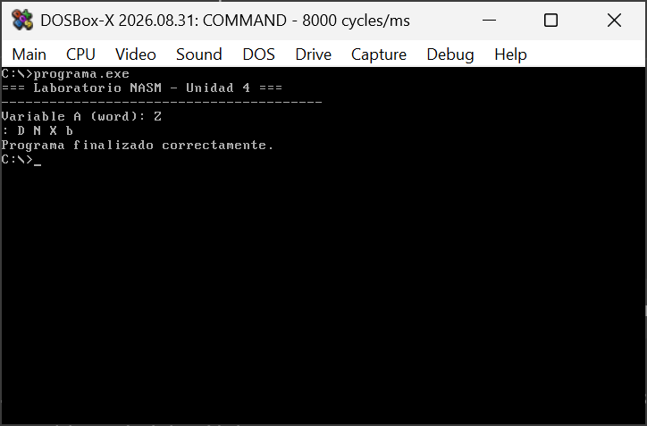
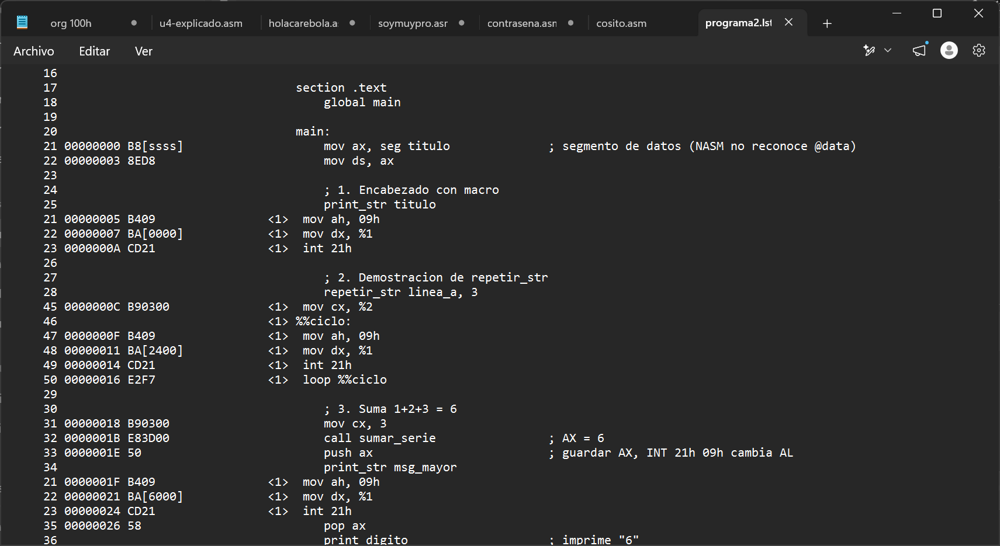
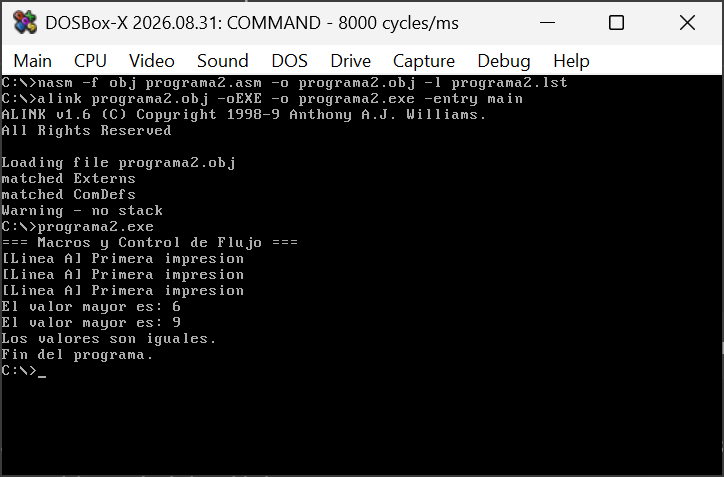
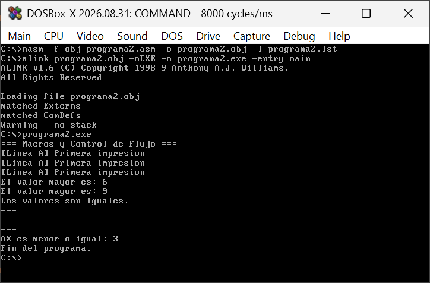

# duran-post1-u4

**Arquitectura de Computadores · Unidad 4 · Post-contenido**

| Dato | Valor |
|---|---|
| Estudiante | Juan Camilo Durán Bohórquez |
| Código | 1152532 |
| Repositorio | duran-post1-u4 |

## Descripción

Laboratorio de la Unidad 4, programa NASM con segmentos y salida DOS en la Parte 1 y macros con control de flujo en la Parte 2. Todo se escribió en archivos .asm, se ensambló con NASM, se enlazó con ALINK y se corrió en DOSBox-X.

## Prerrequisitos

- DOSBox 0.74+ o DOSBox-X, se usó DOSBox-X 2026.08.31
- NASM 2.14+, se usó NASM 2.16.03 para DOS, compilado el 17 de abril de 2024
- ALINK, se usó ALINK 1.6 bajado de alink.sourceforge.net
- Editor de texto plano, los .asm se guardaron en ASCII sin BOM

## Estructura del repositorio

```
duran-post1-u4/
├── README.md
├── programa.asm        Parte 1
├── macros.asm          Parte 2
├── programa2.asm       Parte 2
└── capturas/
```

nasm.exe, alink.exe y los .obj, .exe y .lst que se generan no se suben al repositorio.

---

# Parte 1: Segmentos, Directivas y Salida por Interrupciones DOS

## Compilación y ejecución

Dentro de DOSBox-X se montó la carpeta del proyecto como C y se corrió esto.

```
C:\> nasm -f obj programa.asm -o programa.obj
C:\> alink programa.obj -oEXE -o programa.exe -entry main
C:\> programa.exe
```

## Qué hace programa.asm

El programa tiene las tres secciones, .data con las cadenas y los datos de prueba de tipo `db`, `dw` y `dd`, .bss con `buffer resb 80` y `resultado resw 1`, y .text con `main`. Las constantes CR, LF, TERMINADOR e ITERACIONES se hicieron con `EQU`, entonces no ocupan memoria y el ensamblador pone el número directo donde se usan.

Lo primero en `main` es cargar DS con el segmento de datos, si no se hace la función 09h busca las cadenas en otro lado y salen caracteres raros. Luego imprime la bienvenida y el separador con INT 21h función 09h, que imprime desde DS:DX hasta encontrar el `$`. Con la función 02h imprime un solo carácter que va en DL, primero `var_byte` más 30h que da 90, o sea la Z, y después recorre `tabla_bytes` con SI como puntero y CX como contador de `LOOP`. Al final imprime el mensaje de fin, la línea de 40 iguales y termina con la función 4Ch.

La tabla tiene 10, 20, 30, 40 y 50, y como el código solo suma 30h, que sirve para un dígito de 0 a 9, en pantalla salen los caracteres `: D N X b`. El comentario de la guía ya avisa que esa conversión solo vale de 0 a 9, entonces es lo esperado.

## Cambios frente al código de la guía

Se copió el código de la guía y solo se cambió lo que no dejaba ensamblar o no daba la salida esperada.

- `mov ax, @data` daba `error: symbol '@data' not defined`. Al buscar se vio que `@data` es de MASM y TASM, en NASM con formato obj se pide el segmento con `seg`, entonces quedó `mov ax, seg bienvenida`.
- La salida esperada del Paso 5 trae la línea Programa finalizado correctamente, pero el código no imprimía `fin_msg` en ningún lado, entonces se agregaron las tres líneas que lo imprimen antes de terminar.
- La raya larga del título se cambió por un guion normal porque la guía pide guardar el .asm en ASCII y ese carácter no es ASCII, en DOSBox salía como basura.
- ALINK no estaba en el PC, se bajó ALINK 1.6 de alink.sourceforge.net y se dejó en `C:\asm\alink`, de ahí se copiaron `ALINK.EXE`, `RSX.EXE` y `RSXNT.DLL` a la carpeta del repo sin subirlos.
- Dentro de DOSBox-X ALINK salía con `rsx_32 loader error: No DPMI-host found!`, al parecer necesita un servidor DPMI, entonces antes de enlazar se deja cargado CWSDPMI con `cwsdpmi -p` y con eso sí enlaza.
- ALINK muestra `Warning - no stack` porque el programa no tiene segmento de pila, se dejó así porque el .exe corre bien igual.

## Checkpoint 1. Ensamblado y enlazado


## Checkpoint 2. Ejecución en DOSBox

Salida obtenida.

```
=== Laboratorio NASM - Unidad 4 ===
----------------------------------------
Variable A (word): Z
: D N X b 
Programa finalizado correctamente.
```



## Paso 7. Línea decorativa con TIMES

Se agregó `linea_gruesa` con `TIMES 40 DB '='` y luego `DB CR, LF, TERMINADOR`. Al reensamblar la salida trae al final una línea de 40 iguales seguidos. En el listado de NASM se ve que esos 40 bytes 3D ya quedan escritos en .data, no hay ninguna instrucción que los arme.


## Decisión técnica 1. EQU frente a %define para ANCHO_LINEA

Al principio no se veía la diferencia porque los dos parecen darle nombre a un número. `EQU` crea un símbolo numérico que resuelve el propio ensamblador, guarda el valor ya calculado y si se intenta definir otra vez con otro valor NASM da error, entonces el valor es uno solo y está verificado. `%define` en cambio es del preprocesador, cambia texto por texto antes de que NASM ensamble una sola instrucción y no revisa nada, solo pega lo que se escribió. Eso se nota con expresiones, si se escribe `%define ANCHO_LINEA 20+20` y luego se usa `ANCHO_LINEA*2` el texto queda `20+20*2` y da 60, mientras con `ANCHO_LINEA EQU 20+20` el símbolo ya vale 40 y da 80. Como ANCHO_LINEA se usa como número en `TIMES` y podría usarse en un `CMP` más adelante, `EQU` es el que evita esas sustituciones ambiguas o mal formadas, porque lo que llega a la instrucción es un valor y no un pedazo de texto. `%define` sí tendría sentido en este mismo programa para texto que se repite literal, por ejemplo el final `CR, LF, TERMINADOR` que llevan casi todas las cadenas, o un fragmento de código que se quiere pegar igual en varios lados. Por eso se escogió `EQU` para el ancho y se deja `%define` para texto.

## Decisión técnica 2. TIMES en .data frente a RESB con relleno en ejecución

Lo primero que se pensó fue escribir los 40 iguales a mano dentro del `DB`, pero contar 40 caracteres a ojo es fácil de dañar y si después se quiere otro ancho toca contar y escribir otra vez. Con `TIMES 40 DB '='` el número aparece una sola vez y cambiar el ancho es cambiar ese número. La otra forma era reservar 40 bytes en .bss con `RESB 40` y llenarlos con un bucle `LOOP` al inicio de `main`, eso funciona y en principio es válido, pero aquí no tiene sentido porque la línea nunca cambia de una ejecución a otra, siempre son los mismos 40 iguales y eso ya se sabe al ensamblar. Con `TIMES` los 40 bytes ya vienen dentro de la imagen del ejecutable y DOS los carga junto con el programa, entonces al arrancar no se ejecuta ninguna instrucción para armarlos. Con `RESB` más el bucle hay que cargar SI, CX y AL y dar 40 vueltas de `mov`, `inc` y `loop`, más o menos 120 instrucciones cada vez que corre el programa, para producir algo fijo. `RESB` queda mejor para datos que solo existen en ejecución, como `buffer`, que se llenaría con lo que escriba el usuario. Por eso se dejó `TIMES` en .data.

---

# Parte 2: Macros con Parámetros y Control de Flujo

## Compilación y ejecución

```
C:\> nasm -f obj programa2.asm -o programa2.obj -l programa2.lst
C:\> alink programa2.obj -oEXE -o programa2.exe -entry main
C:\> programa2.exe
```

Como programa2.asm tiene 9 letras antes del punto y el DOS normal solo deja 8, en el `dosbox.conf` local se puso `ver=7.1` y `lfn=true` en la sección `[dos]`, y así los comandos de arriba funcionan con el nombre largo. Antes de `alink` también se deja cargado CWSDPMI con `cwsdpmi -p`.

## Qué hacen macros.asm y programa2.asm

macros.asm solo tiene macros, `fin_dos`, `nueva_linea`, `print_str`, `print_char`, `leer_char`, `repetir_str`, `print_digito` y `bloque_decorativo`, y programa2.asm lo mete con `%include`, que pega el texto tal cual en ese punto. `repetir_str` recibe la cadena y las repeticiones, usa CX con `LOOP` y su etiqueta es `%%ciclo` para que cada expansión tenga un nombre distinto. `print_digito` toma el nibble bajo de AL, le suma 30h y lo imprime.

En programa2.asm el procedimiento `sumar_serie` suma de N hasta 1 con AX de acumulador y CX de contador, con N igual a 3 el `LOOP` da 3 vueltas y AX queda en 6. `comparar_e_imprimir` hace `CMP AX, BX` y decide con `JE` y `JG`, y `comparar_menor_o_igual` hace lo mismo pero decide con `JLE`. Los dos guardan AX y BX con `PUSH` y `POP`.

## Cambios frente al código de la guía

- Igual que en la Parte 1, `mov ax, @data` se cambió por `mov ax, seg titulo`.
- Antes de cada print_str que va seguido de print_digito se guarda AX con push y pop, porque con el código tal cual la función 09h cambia AL y salía el dígito 4 en vez del valor correcto.

## Checkpoint 1. Listado con las macros expandidas

En programa2.lst se ve cada llamada a macro con su código ya pegado, por ejemplo `repetir_str linea_a, 3` aparece con `mov cx, %2`, `mov dx, %1`, `int 21h` y `loop`, y al lado el código máquina ya resuelto, por ejemplo `B90300` que es `mov cx` con 3.



## Checkpoint 2. Ejecución completa

```
=== Macros y Control de Flujo ===
[Linea A] Primera impresion
[Linea A] Primera impresion
[Linea A] Primera impresion
El valor mayor es: 6
El valor mayor es: 9
Los valores son iguales.
Fin del programa.
```



## Pasos 7, 8 y 11. Extensiones con %rep y JLE

Se agregó `bloque_decorativo`, que con `%rep` copia `print_str separador_corto` las veces que se le pida, y el procedimiento `comparar_menor_o_igual`. En `main` se llaman antes del mensaje final con 3 copias y con AX 3 y BX 8.

```
=== Macros y Control de Flujo ===
[Linea A] Primera impresion
[Linea A] Primera impresion
[Linea A] Primera impresion
El valor mayor es: 6
El valor mayor es: 9
Los valores son iguales.
---
---
---
AX es menor o igual: 3
Fin del programa.
```



## Decisión técnica 3. %rep frente a LOOP para un número de repeticiones fijo

No era claro para qué servía `%rep` si `repetir_str` ya repetía. Mirando programa2.lst se vio la diferencia, `%rep` copia el código tal cual las veces que diga su argumento antes de ensamblar, entonces `bloque_decorativo 3` queda como tres `print_str` seguidos y cada uno ocupa 7 bytes, `mov ah, 09h` de 2, `mov dx` de 3 e `int 21h` de 2, en total 21 bytes. Para 3 copias fijas eso es razonable, casi igual a los 12 bytes de `repetir_str`, y no gasta nada en controlar el ciclo. Pero con 1000 copias serían 7000 bytes de código máquina, mientras `repetir_str` sigue en 12 bytes sin importar cuántas vueltas dé, porque el tamaño no depende del conteo. Si el número de repeticiones se leyera en ejecución, por ejemplo con `leer_char`, `bloque_decorativo` ya no sirve porque `%rep` necesita el número al ensamblar y ese valor solo existe cuando el programa corre, ahí lo correcto es `repetir_str`, que carga el valor en CX y lo cuenta con `LOOP`. En el listado de `repetir_str` aparecen `mov cx` y `loop`, que son las instrucciones de control del ciclo, y en el de `bloque_decorativo` no aparece ninguna de las dos, solo las tres copias. Esa ausencia es justo el costo cero en ejecución de `%rep`, no hay contador que decrementar ni salto que evaluar.

## Decisión técnica 4. Etiquetas locales %% en las extensiones

Se probó quitar el `%%` de `repetir_str` y al llamarla dos veces NASM dio error de símbolo redefinido, porque cada llamada copia la etiqueta `ciclo` otra vez. `bloque_decorativo` en cambio no tiene ninguna etiqueta ni ningún salto, solo copias seguidas de `print_str`, entonces aunque se llame varias veces no hay ningún nombre que se repita y no necesita `%%` ni otra etiqueta. Si se le pusiera un salto condicional para saltarse la última copia, ese salto necesita una etiqueta de destino dentro del cuerpo de la macro, y desde ese momento cada expansión volvería a definir el mismo nombre, ahí sí toca `%%` para que NASM le dé un nombre distinto a cada expansión. O sea lo que trae el requisito es tener una etiqueta dentro de la macro, y eso pasa apenas hay un salto hacia ella. `comparar_menor_o_igual` usa `.menor_o_igual` y `.fin_cmp2` con punto, que son etiquetas locales de NASM, NASM les pega el nombre de la última etiqueta normal, entonces quedan como `comparar_menor_o_igual.fin_cmp2` y no chocan con `comparar_e_imprimir.fin_comp`. Además los procedimientos se escriben una sola vez en el archivo y no se expanden en cada llamada como una macro, entonces el punto alcanza y `%%` no hace falta.

## Referencias

Duntemann, J. (2009). *Assembly language step-by-step: Programming with Linux* (3rd ed.). Wiley.

NASM Development Team. (2023). *NASM, the Netwide Assembler: Documentation*. https://www.nasm.us/doc/

DOSBox-X Team. (2026). *DOSBox-X* [Software]. https://dosbox-x.com
