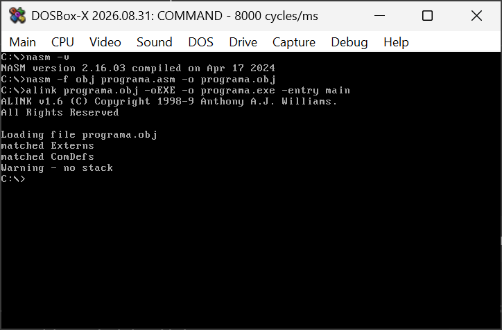
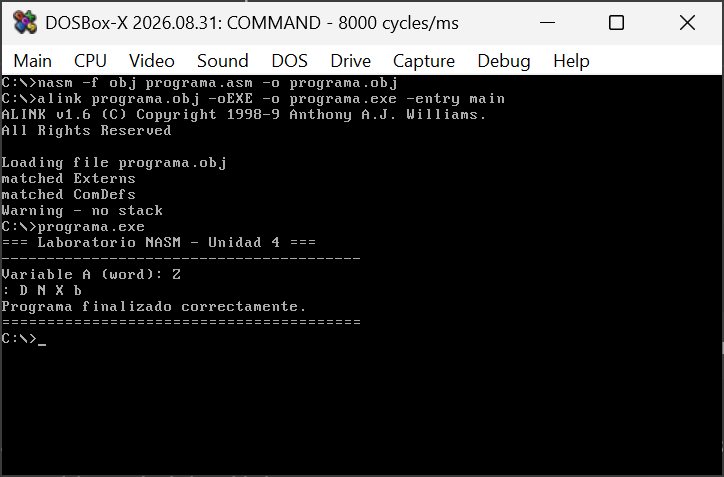

# duran-post1-u4

**Arquitectura de Computadores · Unidad 4 · Post-contenido**

| Dato | Valor |
|---|---|
| Estudiante | Juan Camilo Durán Bohórquez |
| Código | 1152532 |
| Repositorio | duran-post1-u4 |

## Descripción

Laboratorio de la Unidad 4, programa NASM con segmentos y salida DOS en la Parte 1 y macros con control de flujo en la Parte 2. Todo se escribió en archivos .asm, se ensambló con NASM, se enlazó con ALINK y se corrió en DOSBox-X.

## Prerrequisitos

- DOSBox 0.74+ o DOSBox-X, se usó DOSBox-X 2026.08.31
- NASM 2.14+, se usó NASM 2.16.03 para DOS, compilado el 17 de abril de 2024
- ALINK, se usó ALINK 1.6 bajado de alink.sourceforge.net
- Editor de texto plano, los .asm se guardaron en ASCII sin BOM

## Estructura del repositorio

```
duran-post1-u4/
├── README.md
├── programa.asm        Parte 1
└── capturas/
```

nasm.exe, alink.exe y los .obj, .exe y .lst que se generan no se suben al repositorio.

---

# Parte 1: Segmentos, Directivas y Salida por Interrupciones DOS

## Compilación y ejecución

Dentro de DOSBox-X se montó la carpeta del proyecto como C y se corrió esto.

```
C:\> nasm -f obj programa.asm -o programa.obj
C:\> alink programa.obj -oEXE -o programa.exe -entry main
C:\> programa.exe
```

## Qué hace programa.asm

El programa tiene las tres secciones, .data con las cadenas y los datos de prueba de tipo `db`, `dw` y `dd`, .bss con `buffer resb 80` y `resultado resw 1`, y .text con `main`. Las constantes CR, LF, TERMINADOR e ITERACIONES se hicieron con `EQU`, entonces no ocupan memoria y el ensamblador pone el número directo donde se usan.

Lo primero en `main` es cargar DS con el segmento de datos, si no se hace la función 09h busca las cadenas en otro lado y salen caracteres raros. Luego imprime la bienvenida y el separador con INT 21h función 09h, que imprime desde DS:DX hasta encontrar el `$`. Con la función 02h imprime un solo carácter que va en DL, primero `var_byte` más 30h que da 90, o sea la Z, y después recorre `tabla_bytes` con SI como puntero y CX como contador de `LOOP`. Al final imprime el mensaje de fin, la línea de 40 iguales y termina con la función 4Ch.

La tabla tiene 10, 20, 30, 40 y 50, y como el código solo suma 30h, que sirve para un dígito de 0 a 9, en pantalla salen los caracteres `: D N X b`. El comentario de la guía ya avisa que esa conversión solo vale de 0 a 9, entonces es lo esperado.

## Cambios frente al código de la guía

Se copió el código de la guía y solo se cambió lo que no dejaba ensamblar o no daba la salida esperada.

- `mov ax, @data` daba `error: symbol '@data' not defined`. Al buscar se vio que `@data` es de MASM y TASM, en NASM con formato obj se pide el segmento con `seg`, entonces quedó `mov ax, seg bienvenida`.
- La salida esperada del Paso 5 trae la línea Programa finalizado correctamente, pero el código no imprimía `fin_msg` en ningún lado, entonces se agregaron las tres líneas que lo imprimen antes de terminar.
- La raya larga del título se cambió por un guion normal porque la guía pide guardar el .asm en ASCII y ese carácter no es ASCII, en DOSBox salía como basura.
- ALINK no estaba en el PC, se bajó ALINK 1.6 de alink.sourceforge.net y se dejó en `C:\asm\alink`, de ahí se copiaron `ALINK.EXE`, `RSX.EXE` y `RSXNT.DLL` a la carpeta del repo sin subirlos.
- Dentro de DOSBox-X ALINK salía con `rsx_32 loader error: No DPMI-host found!`, al parecer necesita un servidor DPMI, entonces antes de enlazar se deja cargado CWSDPMI con `cwsdpmi -p` y con eso sí enlaza.
- ALINK muestra `Warning - no stack` porque el programa no tiene segmento de pila, se dejó así porque el .exe corre bien igual.

## Checkpoint 1. Ensamblado y enlazado



## Checkpoint 2. Ejecución en DOSBox

Salida obtenida.

```
=== Laboratorio NASM - Unidad 4 ===
----------------------------------------
Variable A (word): Z
: D N X b 
Programa finalizado correctamente.
```


## Paso 7. Línea decorativa con TIMES

Se agregó `linea_gruesa` con `TIMES 40 DB '='` y luego `DB CR, LF, TERMINADOR`. Al reensamblar la salida trae al final una línea de 40 iguales seguidos. En el listado de NASM se ve que esos 40 bytes 3D ya quedan escritos en .data, no hay ninguna instrucción que los arme.



## Decisión técnica 1. EQU frente a %define para ANCHO_LINEA

Al principio no se veía la diferencia porque los dos parecen darle nombre a un número. `EQU` crea un símbolo numérico que resuelve el propio ensamblador, guarda el valor ya calculado y si se intenta definir otra vez con otro valor NASM da error, entonces el valor es uno solo y está verificado. `%define` en cambio es del preprocesador, cambia texto por texto antes de que NASM ensamble una sola instrucción y no revisa nada, solo pega lo que se escribió. Eso se nota con expresiones, si se escribe `%define ANCHO_LINEA 20+20` y luego se usa `ANCHO_LINEA*2` el texto queda `20+20*2` y da 60, mientras con `ANCHO_LINEA EQU 20+20` el símbolo ya vale 40 y da 80. Como ANCHO_LINEA se usa como número en `TIMES` y podría usarse en un `CMP` más adelante, `EQU` es el que evita esas sustituciones ambiguas o mal formadas, porque lo que llega a la instrucción es un valor y no un pedazo de texto. `%define` sí tendría sentido en este mismo programa para texto que se repite literal, por ejemplo el final `CR, LF, TERMINADOR` que llevan casi todas las cadenas, o un fragmento de código que se quiere pegar igual en varios lados. Por eso se escogió `EQU` para el ancho y se deja `%define` para texto.

## Decisión técnica 2. TIMES en .data frente a RESB con relleno en ejecución

Lo primero que se pensó fue escribir los 40 iguales a mano dentro del `DB`, pero contar 40 caracteres a ojo es fácil de dañar y si después se quiere otro ancho toca contar y escribir otra vez. Con `TIMES 40 DB '='` el número aparece una sola vez y cambiar el ancho es cambiar ese número. La otra forma era reservar 40 bytes en .bss con `RESB 40` y llenarlos con un bucle `LOOP` al inicio de `main`, eso funciona y en principio es válido, pero aquí no tiene sentido porque la línea nunca cambia de una ejecución a otra, siempre son los mismos 40 iguales y eso ya se sabe al ensamblar. Con `TIMES` los 40 bytes ya vienen dentro de la imagen del ejecutable y DOS los carga junto con el programa, entonces al arrancar no se ejecuta ninguna instrucción para armarlos. Con `RESB` más el bucle hay que cargar SI, CX y AL y dar 40 vueltas de `mov`, `inc` y `loop`, más o menos 120 instrucciones cada vez que corre el programa, para producir algo fijo. `RESB` queda mejor para datos que solo existen en ejecución, como `buffer`, que se llenaría con lo que escriba el usuario. Por eso se dejó `TIMES` en .data.

## Referencias

Duntemann, J. (2009). *Assembly language step-by-step: Programming with Linux* (3rd ed.). Wiley.

NASM Development Team. (2023). *NASM, the Netwide Assembler: Documentation*. https://www.nasm.us/doc/

DOSBox-X Team. (2026). *DOSBox-X* [Software]. https://dosbox-x.com
